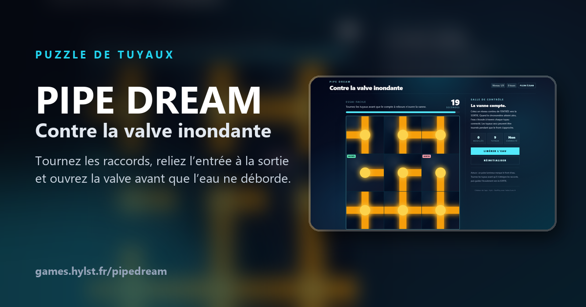

# Pipe Dream

**Contre la valve inondante.**

Pipe Dream, le puzzle de tuyaux contre le temps : tournez les raccords, reliez l'entrée à la sortie et ouvrez la valve avant que l'eau ne déborde. Neuf niveaux.

Joue ici : [games.hylst.fr/pipedream/](https://games.hylst.fr/pipedream/)



## Comment on joue

- Neuf niveaux avec chrono : les tuyaux secs se tournent tant que le front d'eau n'est pas passé.
- Compteur de tuyaux mouillés et de raccords connectés, libération de l'eau et réinitialisation.
- Pulse lumineux du front d'eau et effets sonores Howler.

## Technique

- React 19, TypeScript, Vite 7 et Tailwind CSS 4.
- Build en un seul fichier `index.html`, sans dépendance à l'exécution.
- Aucune requête réseau pendant la partie, aucun compte, aucun cookie.

```bash
npm ci
npm run build
```

Le build sort dans `dist/`. Le fichier `index.html` suffit pour jouer ; `og-image.png` et `icon.webp` accompagnent la publication.

## Structure

```
src/App.tsx   plateau, chrono, niveaux et états
src/index.css thème et animations
src/utils/cn.ts fusion de classes
```

## Licence

AGPL-3.0-or-later. Voir `LICENSE`.

Jeu créé par Geoffroy (Hylst) avec l'aide d'une IA.
